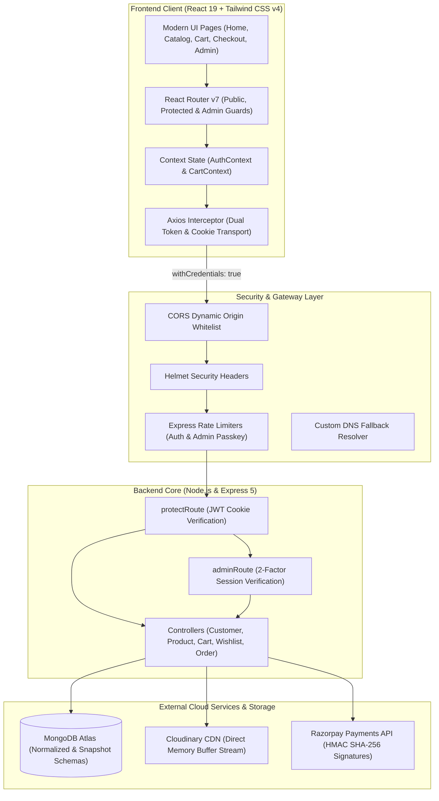
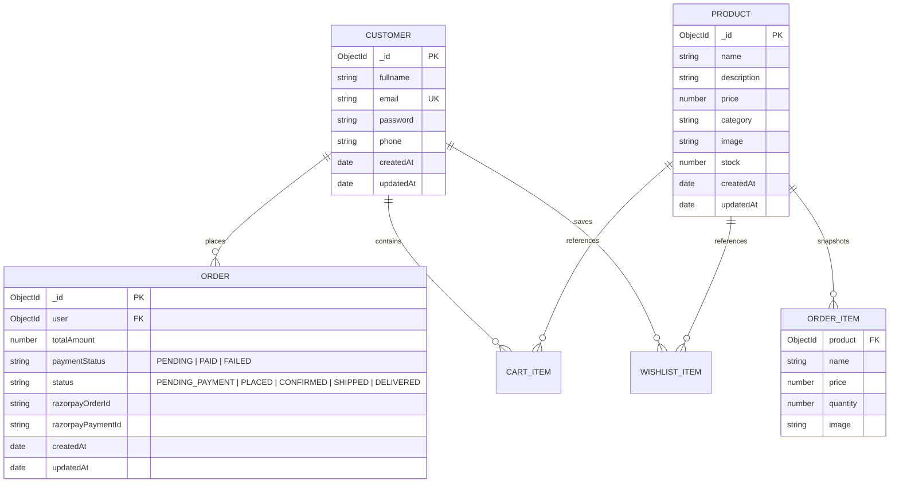

# ShopKart 🛍️✨ — Enterprise Full-Stack E-Commerce Platform

[](https://www.mongodb.com/)
[](https://react.dev/)
[](https://tailwindcss.com/)
[](https://expressjs.com/)
[](https://razorpay.com/)
[](https://cloudinary.com/)
[](https://github.com/)

**ShopKart** is a production-grade, full-stack e-commerce application engineered with hardened multi-layer security, atomic inventory management, cryptographic payment verification, and an ultra-responsive user experience built on **React 19**, **Express 5**, **Node.js**, **MongoDB Atlas**, and **Tailwind CSS v4**.

---

## 📑 Table of Contents
- [System Architecture](#-system-architecture)
- [Key Features & Technical Deep Dives](#-key-features--technical-deep-dives)
  - [1. Razorpay Payment Gateway & Order Lifecycle](#1-razorpay-payment-gateway--order-lifecycle)
  - [2. Two-Factor Admin Security Gateway](#2-two-factor-admin-security-gateway)
  - [3. Concurrency-Safe Atomic Inventory](#3-concurrency-safe-atomic-inventory)
  - [4. Product Catalog & Cloudinary CDN Engine](#4-product-catalog--cloudinary-cdn-engine)
  - [5. Reactive Cart & Wishlist Synchronization](#5-reactive-cart--wishlist-synchronization)
  - [6. Multi-Layer Security Architecture](#6-multi-layer-security-architecture)
- [Tech Stack & Versions](#-tech-stack--versions)
- [Database Schema & ERD](#-database-schema--erd)
- [REST API Reference Summary](#-rest-api-reference-summary)
- [Project Directory Structure](#-project-directory-structure)
- [Environment Variables Configuration](#-environment-variables-configuration)
- [Local Development & Quickstart](#-local-development--quickstart)
- [First-Time Admin & Checkout Testing Guide](#-first-time-admin--checkout-testing-guide)
- [Troubleshooting & Common Gotchas](#-troubleshooting--common-gotchas)
- [Detailed Technical Documentation Links](#-detailed-technical-documentation-links)

---

## 🏗️ System Architecture



---

## 🌟 Key Features & Technical Deep Dives

### 1. Razorpay Payment Gateway & Order Lifecycle
- **Tamper-Proof Server Calculation:** Client requests never submit cart prices or totals. When `/api/orders/create-payment-order` is called, the backend reads live product documents directly from MongoDB, verifies current inventory, and calculates checkout amounts server-side.
- **Cryptographic Signature Verification:** Upon payment completion on the frontend, Razorpay returns `razorpay_payment_id` and `razorpay_signature`. The backend validates the payment signature via HMAC SHA-256 using `RAZORPAY_KEY_SECRET`:
  ```text
  Expected Signature = HMAC-SHA256(order_id + "|" + payment_id, RAZORPAY_KEY_SECRET)
  ```
- **Idempotency & Double-Verification Prevention:** Once verified, orders transition to `PAID` status, stock is decremented, and the user's cart is flushed. Replay requests are safely acknowledged without duplicate deductions.
- **4-Stage Order Progression:** Orders follow a strict progression pipeline:
  `PLACED` ➔ `CONFIRMED` ➔ `SHIPPED` ➔ `DELIVERED`
  Customers and administrators track this progression through a visual `OrderStatusStepper` component.
- **Abandoned Order Cleanup:** Unpaid checkout sessions (`PENDING_PAYMENT`) are filtered out of customer archives and discarded when the customer cancels checkout via `/api/orders/:id/cancel-pending`.

### 2. Two-Factor Admin Security Gateway
Unlike naive applications that rely on client-side route guards or local storage flags:
1. **Server-Side Whitelist:** The backend inspects `req.user.email` against an environment-defined `ADMIN_EMAIL` whitelist.
2. **Cryptographic Passkey Verification:** To access admin capabilities, the user must provide a secret passkey (`ADMIN_KEY`) verified via `/customers/verify-admin-key`.
3. **4-Hour Signed Admin Session:** Upon successful verification, the server generates a 4-hour JWT token with `{ role: 'admin' }` delivered via both an HTTP-only `admin_session` cookie and the `x-admin-token` header.
4. **DevTools Bypass Immune:** If an unauthorized user attempts to manipulate React state or local storage in browser DevTools, every admin API endpoint (`POST/PUT/DELETE /products`, `GET/PATCH/DELETE /api/orders/admin/*`) returns `403 Forbidden`.

### 3. Concurrency-Safe Atomic Inventory
In flash sales where multiple customers attempt to purchase the last unit simultaneously, standard read-then-write code causes negative inventory race conditions. ShopKart uses atomic MongoDB operations:
```javascript
await Product.findOneAndUpdate(
    { _id: item.product, stock: { $gte: item.quantity } },
    { $inc: { stock: -item.quantity } }
);
```
MongoDB's document-level locks ensure that stock updates are strictly serialized and cannot drop below zero.

### 4. Product Catalog & Cloudinary CDN Engine
- **Direct Memory Buffer Uploads:** Admin product photos are accepted via `multer` memory storage and streamed directly to Cloudinary without persisting temporary files to the local server disk.
- **ReDoS Sanitization:** Public product search queries are sanitized with regular expression escaping to prevent catastrophic backtracking attacks from freezing the event loop.
- **Dynamic Filtering & Sorting:** Fast filtering by category and sorting by price (`price_asc`, `price_desc`).
- **Low Stock Indicators:** Automatic visual warnings for items with low stock (≤ 5 units) and out-of-stock disablement.

### 5. Reactive Cart & Wishlist Synchronization
- **Normalized Cart Schema:** Carts store product `ObjectId` references rather than frozen prices. When an admin updates product pricing or details, customer carts automatically reflect current catalog rates upon reload.
- **Warehouse Stock Ceilings:** Quantities in the cart are constrained to available inventory (`quantity <= product.stock`).
- **Reactive Global State:** Context API providers (`AuthContext`, `CartContext`) synchronize cart badge counts, item counters, and drawer states in real time.

### 6. Multi-Layer Security Architecture
- **Brute-Force Rate Limiting:** Powered by `express-rate-limit` (10 login/register requests per 15 min; 5 admin key attempts per 15 min).
- **HTTP Security Headers:** `helmet` protects against XSS, clickjacking, and MIME sniffing with cross-origin resource policy enabled.
- **HTTP-Only Cookies:** Authentication tokens are stored in `httpOnly`, `sameSite: "strict"`, and environment-aware `secure` cookies to eliminate XSS token theft.
- **Strict ObjectId Validation:** All URL parameters are validated via `mongoose.Types.ObjectId.isValid` before querying the database, preventing unhandled `CastError` 500 exceptions.

---

## 🛠️ Tech Stack & Versions

| Layer | Technologies & Libraries |
| :--- | :--- |
| **Frontend Framework** | React 19 (`react` ^19.2, `react-dom` ^19.2) |
| **Build Tool & Bundler** | Vite 8 (`vite` ^8.2, `@vitejs/plugin-react` ^6.1) |
| **Routing** | React Router v7 (`react-router-dom` ^7.18) |
| **Styling & Design** | Tailwind CSS v4 (`@tailwindcss/vite` ^4.3, `tailwindcss` ^4.3) |
| **Notifications** | React Hot Toast (`react-hot-toast` ^2.6) |
| **HTTP Client** | Axios (`axios` ^1.20) with Request Interceptors |
| **Backend Runtime** | Node.js (ES Modules `type: "module"`) |
| **Web Framework** | Express 5 (`express` ^5.2) |
| **Database & ODM** | MongoDB Atlas with Mongoose 9 (`mongoose` ^9.9) |
| **Payment Gateway** | Razorpay Node.js SDK (`razorpay` ^2.9) |
| **Media & Storage** | Cloudinary SDK (`cloudinary` ^2.11) & Multer (`multer` ^2.4) |
| **Security & Auth** | Bcrypt (`bcrypt` ^6.0), JWT (`jsonwebtoken` ^9.0), Helmet (`helmet` ^8.3), Rate Limit (`express-rate-limit` ^8.7) |

---

## 🗄️ Database Schema & ERD



### Schema Design Decisions
1. **Normalized Carts & Wishlists:** Storing `Product` ObjectIds in `Customer.cart` and `Customer.wishlist` preserves database normalization. Price changes in the catalog immediately reflect across all active carts.
2. **Denormalized Order Snapshots:** When an order is placed, line items (`Order.items`) are saved as immutable snapshot subdocuments containing the product name, unit price, quantity, and image at the exact instant of purchase. Future edits or deletions of catalog products do not alter historical invoices.

---

## 📡 REST API Reference Summary

> 📘 **Full API Documentation:** For complete request payloads, parameter schemas, and error codes, refer to the [REST API Reference](file:///d:/ALL/Study/Personal%20Projects/shopkart_mine/docs/API_REFERENCE.md).

### 🔐 Authentication & Profile (`/customers`)
| Method | Endpoint | Access | Description |
| :--- | :--- | :---: | :--- |
| `POST` | `/customers/register` | Public | Register new customer; sets HTTP-only `token` cookie (Rate limited: 10/15m) |
| `POST` | `/customers/login` | Public | Authenticate customer; sets HTTP-only `token` cookie (Rate limited: 10/15m) |
| `POST` | `/customers/logout` | Private | Clear session and admin cookies |
| `GET` | `/customers/me` | Private | Fetch customer profile, cart, wishlist, and dynamic `isAdmin` status |
| `PUT` | `/customers/me` | Private | Update name, email, or phone number |
| `PATCH`| `/customers/change-password` | Private | Change password with old password verification |
| `POST` | `/customers/verify-admin-key`| Admin | Verify secret passkey and issue 4h signed admin session (Rate limited: 5/15m) |

### 📦 Products Catalog (`/products`)
| Method | Endpoint | Access | Description |
| :--- | :--- | :---: | :--- |
| `GET` | `/products` | Public | List products with ReDoS-safe search, category filter, and price sort |
| `GET` | `/products/:id` | Public | Fetch single product by MongoDB ObjectId |
| `POST` | `/products` | Admin | Create product with direct Cloudinary image upload (`multipart/form-data`) |
| `PUT` | `/products/:id` | Admin | Update product information, price, inventory stock, or image |
| `DELETE`| `/products/:id` | Admin | Permanently remove product from catalog |

### 🛒 Shopping Cart (`/cart`)
| Method | Endpoint | Access | Description |
| :--- | :--- | :---: | :--- |
| `GET` | `/cart` | Private | Fetch current user's populated cart items |
| `POST` | `/cart/:productId` | Private | Add item to cart or increment quantity (capped by stock) |
| `PATCH`| `/cart/:productId` | Private | Update exact item quantity (`{ quantity }`) |
| `DELETE`| `/cart/:productId` | Private | Remove item from cart |

### ❤️ Wishlist (`/wishlist`)
| Method | Endpoint | Access | Description |
| :--- | :--- | :---: | :--- |
| `GET` | `/wishlist` | Private | Retrieve user's populated wishlist |
| `POST` | `/wishlist/:productId` | Private | Add product to wishlist (prevents duplicate entries) |
| `DELETE`| `/wishlist/:productId` | Private | Remove item from wishlist |

### 💳 Orders & Payments (`/api/orders`)
| Method | Endpoint | Access | Description |
| :--- | :--- | :---: | :--- |
| `POST` | `/api/orders/create-payment-order` | Private | Re-verify stock, calculate tamper-proof total, create Razorpay order |
| `POST` | `/api/orders/verify-payment` | Private | Validate HMAC SHA-256 signature, mark order `PAID`, atomically decrement stock |
| `GET` | `/api/orders` | Private | Retrieve customer's confirmed order history |
| `GET` | `/api/orders/:id` | Private | Fetch detailed order summary and status stepper |
| `DELETE`| `/api/orders/:id/cancel-pending` | Private | Clean up unfulfilled checkout session when modal is dismissed |
| `GET` | `/api/orders/admin/all` | Admin | Retrieve all store orders across customers with contact info |
| `PATCH`| `/api/orders/admin/:id/status` | Admin | Transition status (`PLACED` ➔ `CONFIRMED` ➔ `SHIPPED` ➔ `DELIVERED`) |
| `DELETE`| `/api/orders/admin/:id` | Admin | Permanently delete order record |

---

## 📁 Project Directory Structure

```plaintext
shopkart_mine/
├── docs/                             # Dedicated Technical Documentation
│   ├── API_REFERENCE.md              # Exhaustive API endpoint schemas & curl examples
│   ├── ARCHITECTURE.md               # Sequence diagrams, security model & concurrency
│   └── DEPLOYMENT.md                 # Production deployment (Render, Vercel, MongoDB Atlas)
├── backend/                          # Express 5 & Node.js REST API
│   ├── config/
│   │   └── razorpay.js               # Razorpay instance initialization
│   ├── controllers/
│   │   ├── customer.controller.js    # Auth, registration, profile, admin key verification
│   │   ├── product.controller.js     # Catalog CRUD, ReDoS escaping, Cloudinary uploads
│   │   ├── cart.controller.js        # Cart management and stock limits
│   │   ├── wishlist.controller.js    # Wishlist operations
│   │   └── order.controller.js       # Razorpay orders, HMAC verification, status transitions
│   ├── middlewares/
│   │   ├── auth.middleware.js        # protectRoute & adminRoute 2-tier authorization
│   │   └── upload.middleware.js      # Multer memory storage configuration
│   ├── models/
│   │   ├── customer.model.js         # Customer, nested cart & wishlist Mongoose schema
│   │   ├── product.model.js          # Product catalog Mongoose schema
│   │   └── order.model.js            # Order lifecycle & snapshot item Mongoose schema
│   ├── routes/
│   │   ├── customer.routes.js        # Auth rate-limited routes
│   │   ├── product.routes.js         # Public & admin catalog routes
│   │   ├── cart.routes.js            # Cart endpoints
│   │   ├── wishlist.routes.js        # Wishlist endpoints
│   │   └── order.routes.js           # Order & payment routes
│   ├── utils/
│   │   ├── cloudinary.js             # Cloudinary configuration
│   │   ├── generateToken.js          # JWT token creation
│   │   ├── uploadCloudinary.js       # Buffer-to-Cloudinary streaming helper
│   │   ├── validateEmail.js          # Email regex validator
│   │   └── validatePhone.js          # Phone number validator
│   ├── .env.example                  # Backend environment template
│   ├── index.js                      # Express server entry point, CORS, Helmet, DNS fixes
│   └── package.json                  # Backend dependencies and scripts
├── frontend/                         # React 19 Single Page Application
│   ├── public/                       # Static public assets
│   ├── src/
│   │   ├── axiosCalls/
│   │   │   └── axios.js              # Axios instance with credentials and admin token interceptor
│   │   ├── components/
│   │   │   ├── AdminRoute.jsx        # Admin route guard with passkey modal trigger
│   │   │   ├── ProtectedRoute.jsx    # Authenticated user route guard
│   │   │   ├── PublicRoute.jsx       # Guest-only route guard (redirects if logged in)
│   │   │   ├── OrderStatusStepper.jsx# Visual 4-stage order fulfillment stepper
│   │   │   └── Footer.jsx            # Dynamic footer with conditional route hiding
│   │   ├── context/
│   │   │   ├── AuthContext.jsx       # Global user identity and login/logout state
│   │   │   └── CartContext.jsx       # Global cart state, item counting, and live updates
│   │   ├── pages/
│   │   │   ├── Home.jsx              # Landing page, hero, category cards, featured products
│   │   │   ├── Products.jsx          # Search, category filter, price sorting, product grid
│   │   │   ├── ProductDetails.jsx    # Full product specifications, stock status, cart actions
│   │   │   ├── Cart.jsx              # Interactive cart drawer with stock ceilings and total
│   │   │   ├── Wishlist.jsx          # Saved favorite items and 1-click cart transfer
│   │   │   ├── Checkout.jsx          # Shipping address form and Razorpay modal trigger
│   │   │   ├── Orders.jsx            # Customer order history list with status badges
│   │   │   ├── OrderDetails.jsx      # Order breakdown, delivery timeline, shipping summary
│   │   │   ├── OrderSuccess.jsx      # Order confirmation and receipt receipt view
│   │   │   ├── AdminOrders.jsx       # Admin orders dashboard, status switcher, order deletion
│   │   │   ├── AdminProducts.jsx     # Admin catalog manager, image uploads, stock editor
│   │   │   ├── Profile.jsx           # User profile info and password changer
│   │   │   ├── Login.jsx             # Secure customer login
│   │   │   ├── Register.jsx          # Customer registration
│   │   │   └── NotFound.jsx          # 404 Error page
│   │   ├── App.jsx                   # Route provider and global layout
│   │   ├── index.css                 # Tailwind CSS v4 directives
│   │   └── main.jsx                  # React DOM mount point
│   ├── index.html                    # HTML entry point with Razorpay Checkout script
│   ├── vite.config.js                # Vite build configuration with Tailwind plugin
│   └── package.json                  # Frontend dependencies and scripts
└── README.md                         # Main repository documentation
```

---

## ⚙️ Environment Variables Configuration

Create a `.env` file inside the `backend/` directory:

```env
# ----------------------------------------------------
# Server Configuration
# ----------------------------------------------------
PORT=5000
NODE_ENV=development
CLIENT_URL=http://localhost:5173

# ----------------------------------------------------
# Database Configuration
# ----------------------------------------------------
# MongoDB Atlas Connection String
dbUrl=mongodb+srv://<username>:<password>@cluster0.mongodb.net/shopkart?retryWrites=true&w=majority

# ----------------------------------------------------
# Authentication Secrets
# ----------------------------------------------------
JWT_SECRET=super_secret_jwt_random_key_min_32_characters

# ----------------------------------------------------
# Two-Factor Admin Access
# ----------------------------------------------------
# Comma-separated list of authorized administrator emails
ADMIN_EMAIL=admin@shopkart.com
# Secret administrator security passkey required to unlock admin sessions
ADMIN_KEY=your_secret_admin_passkey_here

# ----------------------------------------------------
# Razorpay Payment Gateway (Test Mode)
# ----------------------------------------------------
RAZORPAY_KEY_ID=rzp_test_your_key_id
RAZORPAY_KEY_SECRET=your_razorpay_secret_here

# ----------------------------------------------------
# Cloudinary CDN (Image Storage)
# ----------------------------------------------------
CLOUDINARY_CLOUD_NAME=your_cloud_name
CLOUDINARY_API_KEY=your_cloudinary_api_key
CLOUDINARY_API_SECRET=your_cloudinary_api_secret
```

---

## 🚀 Local Development & Quickstart

### Prerequisites
- Node.js (v18.0.0 or higher recommended)
- npm (v9.0.0 or higher)
- Active MongoDB Atlas cluster or local MongoDB instance

### Step 1: Clone Repository
```bash
git clone https://github.com/Manas-5461X/shopkart.git
cd shopkart_mine
```

### Step 2: Configure Backend
```bash
cd backend
npm install
# Copy the environment template and populate your keys:
cp .env.example .env
```

### Step 3: Configure Frontend
```bash
cd ../frontend
npm install
```

### Step 4: Run Application
Open two terminal windows:

**Terminal 1 (Backend Server):**
```bash
cd backend
npm run dev
```
*Backend runs at `http://localhost:5000` (or `PORT` specified in `.env`).*

**Terminal 2 (Frontend Client):**
```bash
cd frontend
npm run dev
```
*Frontend runs at `http://localhost:5173`.*

---

## 🧪 First-Time Admin & Checkout Testing Guide

### 1. Creating the First Administrator Account
1. Open `http://localhost:5173/register` in your browser.
2. Register a new user with the email configured in your `backend/.env` under `ADMIN_EMAIL` (e.g., `admin@shopkart.com`).
3. Once registered, click the **Admin** link in the navigation bar.
4. When prompted by the security modal, input the passkey configured in `ADMIN_KEY`.
5. The dashboard unlocks and your browser receives a 4-hour cryptographically signed session token.

### 2. Creating Store Products
1. In the Admin navigation, go to **Admin Products** (`/admin/products`).
2. Fill out product name, description, category, unit price, and stock units.
3. Select an image file (`.jpg`, `.png`, `.webp`) and click **Save Product**.
4. The image streams directly to Cloudinary and the product immediately appears in the customer store catalog.

### 3. Testing Razorpay Payments (Test Mode)
1. Navigate to the store catalog as a customer and add an item to your cart.
2. Go to **Checkout** (`/checkout`), enter delivery details, and click **Pay with Razorpay**.
3. Use Razorpay's simulated payment credentials:
   - **Card Number:** `4111 1111 1111 1111`
   - **Expiry Date:** Any future date (e.g., `12/28`)
   - **CVV:** Any 3 digits (e.g., `123`)
   - **OTP:** `1234` or click **Success** in the mock popup.
4. The payment signature is verified, inventory decrements atomically, and you are redirected to `/order-success/:id`.
5. Check `/orders` to view your order and monitor the real-time fulfillment stepper.

---

## 🔍 Troubleshooting & Common Gotchas

### 1. MongoDB Atlas DNS SRV Resolution Issue (Windows)
**Symptom:** `MongooseServerSelectionError: querySrv ENOTFOUND _mongodb._tcp.cluster0...`  
**Root Cause:** Certain local Windows network providers block DNS SRV records for MongoDB Atlas clusters.  
**Solution:** The backend includes a built-in resolver fix in `backend/index.js` setting Google's public DNS servers:
```javascript
dns.setServers([
  '8.8.8.8',
  '[2001:4860:4860::8888]',
  '8.8.8.8:1053',
  '[2001:4860:4860::8888]:1053',
]);
```

### 2. CORS Blocked or Missing Cookies on Localhost
**Symptom:** Requests fail with `Blocked by CORS policy` or authenticated requests return `401 Unauthorized`.  
**Solution:**
- Ensure `withCredentials: true` is enabled in `frontend/src/axiosCalls/axios.js`.
- Verify `backend/.env` has `CLIENT_URL=http://localhost:5173`.
- In local development, cookies require `secure: false` because localhost does not run on HTTPS. In production (`NODE_ENV=production`), `secure: true` is automatically enabled.

### 3. Razorpay Modal Does Not Open
**Symptom:** Clicking "Place Order" results in `Razorpay is not defined`.  
**Solution:** Ensure `frontend/index.html` includes the official Razorpay script tag in the `<head>`:
```html
<script src="https://checkout.razorpay.com/v1/checkout.js"></script>
```

### 4. Admin Key Prompt Loop
**Symptom:** Entering the correct admin passkey keeps prompting for the key again.  
**Solution:**
- Verify `backend/.env` has `ADMIN_KEY` configured.
- Ensure the user's registered email matches `ADMIN_EMAIL` exactly (case-insensitive).
- Check that the browser is not blocking third-party or session cookies. The custom Axios interceptor also automatically attaches `x-admin-token` from `sessionStorage` as a fallback.

---

## 📚 Detailed Technical Documentation Links

For deeper architectural breakdowns, deployment instructions, and full API specifications, inspect our dedicated technical guides:

- 📡 **[REST API Reference & Specification](file:///d:/ALL/Study/Personal%20Projects/shopkart_mine/docs/API_REFERENCE.md)** — Exhaustive schemas, status codes, query parameters, and cURL examples for every route.
- 🏗️ **[System Architecture & Security Model](file:///d:/ALL/Study/Personal%20Projects/shopkart_mine/docs/ARCHITECTURE.md)** — Sequence diagrams, two-factor admin flow, race-condition mitigation, and state machines.
- 🚀 **[Production Deployment & Hosting Guide](file:///d:/ALL/Study/Personal%20Projects/shopkart_mine/docs/DEPLOYMENT.md)** — Step-by-step instructions for deploying to Render, Vercel, MongoDB Atlas, and securing production environments.

---

*ShopKart is designed and maintained to showcase modern, reliable, and secure full-stack software engineering standards.*
